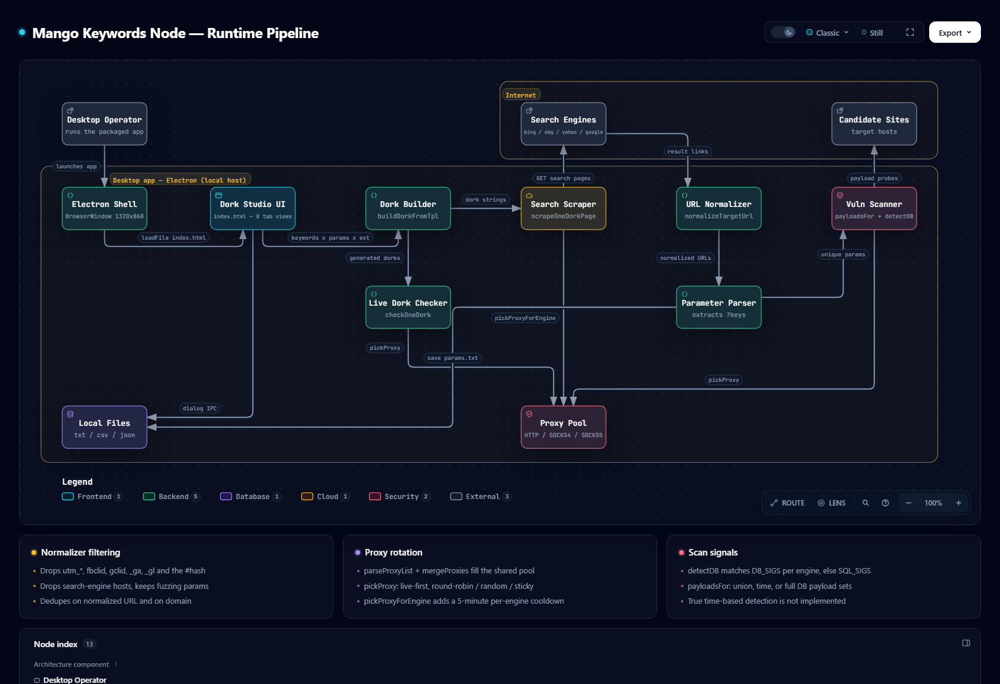

# GG-Dork-Dump-Y-Site — Mango Keywords v3.5 LTS (Dork Studio)

> Desktop workbench for turning a keyword list into parameterized search dorks, harvesting
> result URLs from four search engines, and triaging the parameters those URLs expose.
> Runs as a single offline-first Electron window — no server, no database, no telemetry.

[](https://github.com/tameruict/GG-Dork-Dump-Y-Site/releases/latest)
[](#-release--download)
[](https://www.electronjs.org/)
[](#license)

---

## The pipeline at a glance

The whole app is one directed path. Every node below is a real module in this repository, and the
diagram is generated from the source at the commit it cites.

<a href="docs/diagrams/mango-keywords-pipeline.html">
  
</a>

**[▶ Open the interactive pipeline diagram](docs/diagrams/mango-keywords-pipeline.html)** — explorable,
self-contained, with dark/light themes and trace animation. Not measured runtime timings: the diagram
is an architecture view, not a benchmark.

> If the `.png` above does not render yet, use the HTML link — it is the authoritative artifact.

### How to read that diagram

| # | Stage | What actually happens | Where |
| :-: | :--- | :--- | :--- |
| 1 | **Operator** | Pastes a keyword list and picks a dork template in the UI. | `index.html`, `renderer.js` |
| 2 | **Electron Shell** | Opens the 1320×860 window and serves the two file dialogs over IPC. | `main.js` |
| 3 | **Dork Studio UI** | Eight side-nav views over one in-memory `S` store; no router, no reload. | `index.html:23-55`, `renderer.js` |
| 4 | **Dork Builder** | `buildDorkFromTpl()` substitutes `{kw}`, `{param}`, `{ext}` per keyword. | `renderer.js` |
| 5 | **Search Scraper** | Fans each dork across Bing, DuckDuckGo, Yahoo and Google, one page per engine, deduped. | `renderer.js` |
| 6 | **URL Normalizer** | `normalizeTargetUrl()` forces HTTP/HTTPS, drops `#hash`, self-links and `utm_*`/`fbclid`/`gclid`/`_ga`/`_gl`. | `renderer.js` |
| 7 | **Parameter Parser** | Collects the surviving `?key=` names and ranks candidates. | `renderer.js` |
| 8 | **Vulnerability Scanner** | Sends `payloadsFor()` probes and classifies DBMS error signatures via `detectDB()`. | `renderer.js` |

Supporting, off the main path: a **Proxy Pool** (HTTP/SOCKS4/SOCKS5, round-robin / random / sticky,
5-minute per-engine cooldown), a **Live Dork Checker**, and **local `.txt`/`.csv`/`.json` files** for
import and export.

**Boundaries.** Everything except the four search engines and the candidate target sites runs inside
the local Electron process. Outbound HTTP(S)/SOCKS traffic is the only thing that crosses it.
Local file reads and writes happen in the Electron **main** process (`main.js`), not in the renderer.

### Known gaps in the diagram

Two behaviours are deliberately *not* drawn as working flows, because the source does not support
them as working flows:

- **`time-based` SQLi payloads are not actually timed.** The payload set exists and is selectable,
  but the scanner explicitly does not measure response delay, so no time-based injection is ever
  confirmed. The diagram marks this rather than drawing a detection path that does not run.
- **Proxy liveness is asserted by the UI, not proven by it.** The pool, rotation and cooldown logic
  are real and sourced; the "live" badge's result handling has no body, so the diagram presents the
  pool and its leases without claiming a verified liveness check.

The committed diagram also carries two crossing relationship lines (both involving the
`Parameter Parser → Local Files` export edge). They are a known cosmetic imperfection, not a
correctness problem: every component, relationship, source citation and boundary is accurate, and
the automated gates pass.

---

## 📦 Release & download

Prebuilt Windows binaries live under **[Releases](https://github.com/tameruict/GG-Dork-Dump-Y-Site/releases/latest)** —
they are deliberately kept out of the git history so cloning stays small.

| Asset | What it is | When to pick it |
| :--- | :--- | :--- |
| `GG-Dork-Dump-Y-Site-<version>.exe` | Electron **portable** single-file build. No installer, no admin rights. | Fastest start. Double-click and run. |
| `GG-Dork-Dump-Y-Site-<version>-win-x64.zip` | The unpacked `win-unpacked/` directory. | Antivirus flags single-file packers, or you want to drop in your own `app.asar`. |
| `SHA256SUMS.txt` | Checksums for every asset above. | Verify your download before running it. |

> **Windows SmartScreen.** The binaries are unsigned, so Windows may show
> *"Windows protected your PC"* on first launch. Choose **More info → Run anyway**. You can confirm
> the file is intact first with the checksums:
>
> ```powershell
> Get-FileHash .\GG-Dork-Dump-Y-Site-*.exe -Algorithm SHA256
> ```

### Build a release yourself

```bash
npm ci          # exact, lockfile-pinned install
npm start       # run from source
npm run build   # electron-builder -> dist/ (portable .exe)
```

`npm run build` only targets Windows x64. Change `build.win.target` in `package.json` to produce an
`nsis` installer or a different architecture.

---

## 🧑💻 Source code

```text
.
├── main.js               # Electron main process: BrowserWindow + dialog IPC
├── index.html            # Single-page UI shell, 8 side-nav views
├── renderer.js           # All application logic: state, dorks, scraper, scanner
├── i18n.js               # Runtime translations (en, ar, ru, zh, vi)
├── style.css             # Theme and layout
├── db_params.txt         # DB-shaped parameter seeds used by Dork Maker
├── sqli_extensions.txt   # SQLi-prone file extensions (php, asp, aspx, jsp, do, cfm, ...)
├── docs/
│   ├── diagrams/         # Archify pipeline diagram embedded above
│   └── designs/          # Design notes, see docs/designs/SITEMAP.md
└── package.json          # Scripts, deps, electron-builder config
```

**Stack:** Electron 44 · Node.js (CommonJS) · axios · `http-proxy-agent` /
`https-proxy-agent` / `socks-proxy-agent`. No bundler, no framework, no build step for the UI.

**Requirements to run from source:** Node.js 18+ and Windows/macOS/Linux with a desktop session.
The renderer relies on `nodeIntegration: true` and `contextIsolation: false`, so it only works inside
the Electron desktop runtime — opening `index.html` in a browser will not bring up the app.

---

## Features

- **Dork Maker** — template compiler with `{kw}`, `{param}`, `{ext}` substitution, checkbox plus
  custom-extension input, live preview, and DB-shaped parameter seeds from `db_params.txt`.
- **Multi-engine Scraper** — Bing, DuckDuckGo, Yahoo and Google adapters behind one interface
  (`buildRequest` / `parseResults` / `isBlocked`), batched DOM updates every 100 ms, deduplicated
  URLs and domains, per-engine cooldown on `429`/`403`/`999`/CAPTCHA.
- **Extractors / Cleaners** — URL normalization (tracking-parameter stripping, hash removal,
  search-engine self-link rejection) and parameter extraction.
- **Vulnerability Scanner** — injection-mode probe payloads, DBMS fingerprinting from error
  signatures (MySQL, MSSQL, PostgreSQL, Oracle, SQLite).
- **Proxy Manager** — bulk paste or file import, deduplication, protocol normalization, latency
  probing, and per-engine sticky/rotating leases.
- **Live Dork Checker** — validates generated dorks against a target engine before a full run.
- **Five UI languages** — English, Arabic, Russian, Chinese, Vietnamese.

---

## Interface reference

### `main.js`
- `createWindow()` — initializes the 1320×860 window (min 1120×700) and loads `index.html`.
- IPC `dialog:openFile` — native picker for `.txt`/`.csv`/`.list`, returns `{ path, content }`.
- IPC `dialog:saveFile` — native save dialog, writes UTF-8 (`txt`/`json`).

### `renderer.js`
State and dorks: `S` (the single state store), `buildDorkFromTpl()`, `getCheckedExtensions()`,
`getCustomExtensions()`, `getSelectedExtensions()`, `setCheckedExtensions()`, `hasExtPlaceholder()`.

Proxies: `normalizeType()`, `isValidHost()`, `parseSingleProxy()`, `parseProxyList()`,
`mergeProxies()`, `refreshProxyUI()`, `renderProxyList()`, `agentFor()`, `pickProxy()`,
`pickProxyForEngine()`, `checkOneDork()`.

Scraping and normalization: `ScraperEngines`, `normalizeTargetUrl()`, `scrapeOneDorkPage()`,
`startScraper()`.

Scanning: `detectDB()`, `payloadsFor()`.

Shell and UI: `openFile()`, `saveFile()`, `goto()`, `updatePreview()`, `parseLines()`.

### `i18n.js`
- `window.MangoI18n` — translation manager with `setLanguage()`, `getLanguage()`, `t()`, `languages`.

---

## Invariants

- Proxy records in `S.proxies` must retain valid `id`, `type`, `host`, `port` and `latency`.
- Dork templates must keep `{kw}` and `{param}` markers to produce parameterized queries.
- The Electron runtime requires `nodeIntegration: true` and `contextIsolation: false`.
- URLs submitted to the scanner must contain query parameters (`?`).
- Engine adapters must implement `name`, `tag`, `buildRequest(query, page)`, `parseResults(html)`
  and `isBlocked(status, data)`.
- DuckDuckGo scraping is restricted to depth 1 (`page === 1`).
- Block cooldowns are per-engine (`proxy.cooldown[engineKey]`, 300 000 ms) and must not mark a
  healthy proxy globally dead.
- With an empty proxy pool, direct mode caps concurrency at 2 threads.
- Normalized URLs must be RFC-compliant HTTP/HTTPS and must exclude search-provider domains.

## Side effects

- Outbound HTTP/HTTPS/SOCKS4/SOCKS5 sockets via `axios` and the proxy-agent drivers.
- Search queries sent to `bing.com`, `html.duckduckgo.com`, `search.yahoo.com`, `google.com`.
- In-memory mutation of `proxy.cooldown[engineKey]` and socket-dropout dead flags.
- Direct disk reads/writes through the `dialog:openFile` and `dialog:saveFile` IPC handlers.
- Clipboard writes via `navigator.clipboard.writeText`.
- DOM mutation across the active view, progress meters and toasts.

---

## Verification

```bash
npm ci                       # reproducible install from the lockfile
node -c renderer.js          # syntax check
node -c main.js
npm start                    # launch the desktop app
```

Regenerating the pipeline diagram is optional and only needed if the pipeline changes; the
generator writes to `docs/diagrams/`. The committed HTML is self-contained and needs no network.

---

## Responsible use

This tool builds dorks, scrapes public search results and probes URLs for SQL-injection **error
signatures**. It does not confirm or exploit a vulnerability, and it ships no exploit payloads.

Use it only against systems you own or are explicitly authorized in writing to test. Dorking and
automated probing of third-party sites without permission may violate computer-misuse law and the
search engines' terms of service. You are responsible for what you point it at.

## License

Released under the **ISC** license — see `package.json`. Bundled Electron and Chromium components
retain their own licenses; the packaged build ships `LICENSE.electron.txt` and
`LICENSES.chromium.html` alongside the binary.
