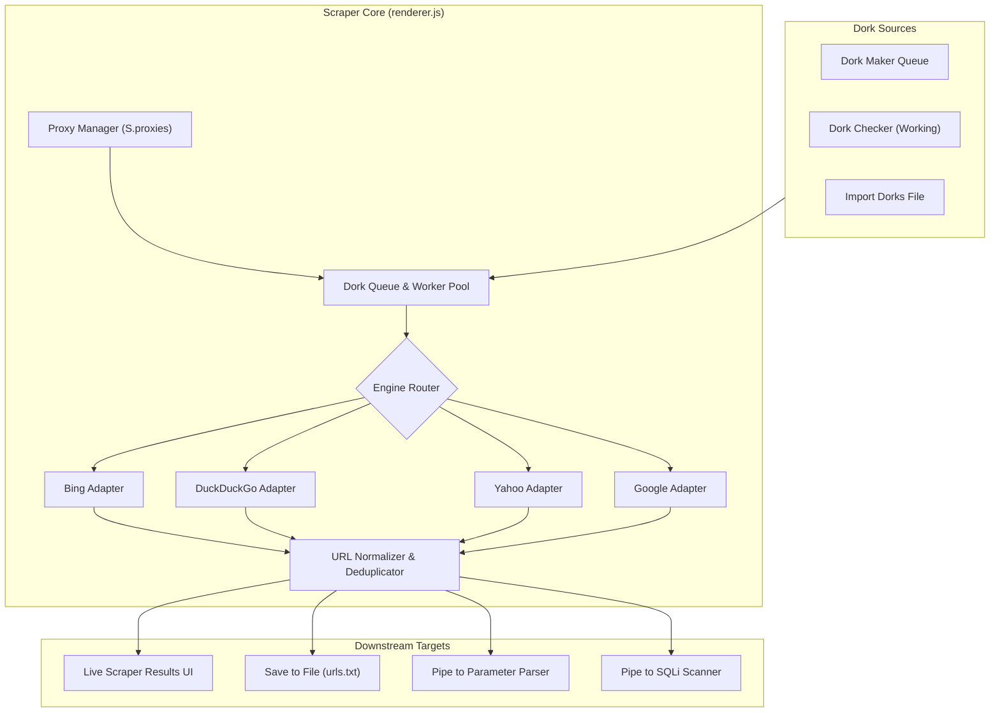

# Multi-Engine Search Scraper Pipeline

* **Author:** bebebe
* **Date:** 2026-10-28
* **Status:** Draft

## The Problem
`mango-keywords-node` provides a Dork Maker to generate parameterized search queries and a Checker that tests query validity against Google. However, the system contains no mechanism to collect and extract actual target URLs from search engine result pages (SERPs). 

Users are forced to export dorks, run third-party scrapers outside the application, and manually import collected URLs back into the Parser and Scanner modules. This disconnect creates unnecessary manual friction, prevents automated pipelining, and leaves the tool unable to autonomously populate its own downstream vulnerability scanning workflows.

## Overview
The Multi-Engine Search Scraper introduces an integrated extraction subsystem that consumes dork queues directly from the Maker or imported text files, executes searches across multiple search providers (Bing, DuckDuckGo, Yahoo, Google), extracts and normalizes organic result URLs, and pipes clean target lists directly into the Parser and Scanner.

The scraper operates via lightweight HTTP requests with configurable concurrency, routing through the existing proxy management subsystem with per-engine rate limiting and failover.

## Goals
* **Automated Pipeline Integration:** Provide seamless 1-click handoff from Dork Maker / Checker output directly into the Scraper, and from Scraper results into the Parser / Scanner.
* **Multi-Engine Support:** Implement modular search engine adapters for Bing, DuckDuckGo, Yahoo, and Google, allowing single-engine or round-robin multi-engine dispatch.
* **Proxy-Aware Concurrency:** Distribute requests across the active proxy pool (`S.proxies`) with per-engine delays, timeout handling, and automatic dead-proxy marking upon encountering rate limits (429) or bot detection.
* **URL Normalization & Deduplication:** Strip search engine tracking redirects (e.g., Google `/url?q=`, Yahoo `r.search.yahoo.com`), filter out non-target domains (search engine self-domains, ads), and deduplicate URLs in real time.
* **Resource Efficiency:** Maintain low memory and CPU footprint by utilizing direct HTTP stream parsing without requiring heavy headless browser runtimes.

## Non-Goals
* **Headless Browser Automation:** Full Chromium/Puppeteer scraping is out of scope for this version; all adapters will use fast HTTP requests and DOM/regex parsing.
* **Paid CAPTCHA Solver Integration:** Third-party solver APIs (2Captcha, CapSolver) are excluded from the initial release; blocked proxies are rotated or marked dead.
* **Deep Web Crawling:** Crawling internal links on discovered target websites (spidering) is not handled by this component; scraping is strictly confined to SERP links.

## Technical Plan

### System Architecture & Data Flow

The scraper subsystem runs as an integrated module within the Electron renderer execution loop, using a multi-worker async queue that coordinates request dispatching across multiple search provider adapters.



### Component Breakdown

#### 1. Engine Adapters (`ScraperEngines`)
Each adapter implements a common contract interface:
```typescript
interface SearchEngineAdapter {
  name: 'bing' | 'ddg' | 'yahoo' | 'google';
  buildUrl(query: string, page: number): string;
  getHeaders(): Record<string, string>;
  parseResults(html: string): string[];
  isBlocked(status: number, body: string): boolean;
}
```

* **Bing Adapter:**
  - Endpoint: `https://www.bing.com/search?q={query}&first={page_offset}`
  - Extraction: Matches `<h2><a href="(https?://[^"]+)"` inside `.b_algo` blocks.
  - Characteristics: Tolerant rate limiting compared to Google; primary engine for high-speed dorking.
* **DuckDuckGo Adapter:**
  - Endpoint: `https://html.duckduckgo.com/html/?q={query}` (HTML non-JS lite endpoint).
  - Extraction: Parses `a.result__url` and `<a class="result__snippet" href="(https?://[^"]+)"`.
  - Redirect Cleaning: Unwraps `/l/?kh=-1&uddg={encoded_target_url}`.
* **Yahoo Adapter:**
  - Endpoint: `https://search.yahoo.com/search?p={query}&b={page_offset}`
  - Extraction: Extracts `href` attributes starting with `https://r.search.yahoo.com/` and unwraps the `/RU={encoded_url}/` target token.
* **Google Adapter:**
  - Endpoint: `https://www.google.com/search?q={query}&start={page_offset}`
  - Extraction: Extracts clean target URLs from `/url?q={target}&` or modern organic link structures.
  - Block Handling: Flags 429, 403, and `/sorry/` responses to trigger immediate proxy disqualification.

#### 2. URL Normalizer & Deduplicator (`UrlNormalizer`)
* **Tracking & Redirect Stripping:** Decodes target URLs embedded inside provider redirect intermediaries (Google `url?q=`, DDG `uddg=`, Yahoo `RU=`).
* **Noise Filter:** Drops search engine domain self-links (`*.google.*`, `*.bing.*`, `*.yahoo.*`, `*.duckduckgo.*`, `*.microsoft.*`, `*.msn.*`, `*.youtube.*`).
* **Protocol & Anchor Canonicalization:** Strips `#fragments`, normalizes scheme to lowercase, and removes trailing default ports (`:80`, `:443`).
* **Deduplication:** Maintains an in-memory `Set<string>` of seen normalized URLs per scrape session. Supports domain-level deduplication (`domainUnique`) to harvest unique target hosts rather than duplicate paths.

#### 3. Worker Concurrency & Rate Limiting (`ScraperWorkerPool`)
* Configurable concurrency pool (`1` to `30` parallel workers).
* User-configurable inter-request delay (`0` to `5000ms`) with random jitter (`+ Math.random() * delay`) to distribute load.
* Proxy routing: Every request pulls from `pickProxy()`. If an adapter signals `isBlocked(status, body) === true`:
  - Mark current proxy `dead`.
  - Re-enqueue current dork/page task with exponential backoff retry (up to 2 retries per task).

#### 4. UI & Downstream Integration (`PipeBridge`)
* New top-level navigation tab: `Scraper` (`view-scraper`).
* Controls:
  - Dork source selector: "Import File", "From Maker (N dorks)", "From Working Checker (N dorks)", or manual multi-line text input.
  - Engine multi-select checkboxes: Bing (default checked), DuckDuckGo (default checked), Yahoo (default checked), Google (optional).
  - Search depth: pages per dork (1 to 5 pages, default 1).
  - Concurrency slider and delay inputs.
  - Action buttons: "Start Scraping", "Stop", "Clear".
* Output Actions:
  - "Send to Parser": Injects harvested URLs into `S.parser` input and switches view to Parser tab.
  - "Send to Scanner": Injects harvested URLs into `S.scanner` input and switches view to Scanner tab.
  - "Export .txt": Native Electron save dialog (`dialog:saveFile`).

### File Impact
* `index.html`: Add `nav-scraper` tab button and `#view-scraper` container with controls, status indicators, and live URL result stream.
* `renderer.js`:
  - Add `S.scraper` state object (`dorks`, `urls`, `stats`, `running`, `workers`).
  - Implement `ScraperEngines` dictionary (Bing, DDG, Yahoo, Google).
  - Implement `extractTargetUrl()`, `normalizeUrl()`, and `scrapeOneDork()`.
  - Bind Scraper UI events (start/stop/export/pipe).
* `style.css`: Add styles for scraper layout, engine badges, counters, and table styling matching the existing dark theme (`#10131a`).
* `i18n.js`: Register translation tokens across `en`, `vi`, `ar`, `ru`, `zh` for all scraper UI labels and notifications.


## Alternatives Considered

### 1. Headless Browser Automation (Puppeteer / Playwright)
* **Approach:** Spawn headless Chromium or Firefox instances in the background to execute JavaScript on search engine pages and bypass simple bot-detection challenges.
* **Why Rejected:**
  * **Resource Footprint:** Each headless browser tab consumes between 150MB and 300MB of RAM. Running 10 to 30 concurrent workers would require 3GB to 9GB of memory and saturate CPU, conflicting directly with the lightweight desktop footprint of Mango Keywords.
  * **Packaging Bloat:** Bundling Chromium browser binaries increases the packaged portable installer (`electron-builder`) size by over 150MB.
  * **Execution Speed:** Browser page evaluation introduces significant latency (2-5s per query) compared to raw HTTP stream parsing (150-400ms per query).

### 2. Commercial Search API Wrappers (SerpAPI, Serper.dev, Custom Search API)
* **Approach:** Offload SERP fetching to third-party paid REST APIs that return structured JSON search results without bot-detection risks.
* **Why Rejected:**
  * **Financial & Quota Bottlenecks:** Bulk dorking operations routinely dispatch thousands to tens of thousands of search queries. Commercial APIs charge per request and impose strict rate caps, making high-volume workflows cost-prohibitive.
  * **Privacy & Telemetry:** Dispatches all operator query patterns and target footprints through third-party servers, compromising operational privacy.
  * **Configuration Friction:** Mandates external API key registration and billing setup, breaking the self-contained, offline-first model of the application.

### 3. External Python / Golang Scraping Daemon
* **Approach:** Delegate scraping and HTML parsing to a background subprocess written in Python (BeautifulSoup / Scrapy) or Go.
* **Why Rejected:**
  * **Host Dependency Fragility:** Requires users to have Python/Go runtimes and dependent modules installed on the host machine, breaking the zero-dependency portable `.exe` distribution.
  * **IPC Overhead:** Introduces complex process lifecycle management, IPC serialization, and zombie process risks if the Electron UI terminates unexpectedly.
  * **Codebase Bifurcation:** Splitting business logic across multiple languages increases maintenance overhead when the existing Node.js runtime already provides native asynchronous I/O and HTTP proxy agents.


## Detailed Implementation

### Touched Files Inventory & Rationales

| File | Status | Rationale |
| :--- | :--- | :--- |
| `index.html` | Modified | Add navigation tab button `nav-scraper`, container `#view-scraper`, configuration controls (inputs, checkboxes, sliders), and results table to expose the scraper functionality in the UI. |
| `renderer.js` | Modified | Houses application state and client runtime logic. Must implement `S.scraper` state model, search engine request adapters, URL normalization, worker queue loop, and tab event listeners. |
| `style.css` | Modified | Define visual layout for the scraper view, engine indicator badges, counters, and table row formatting consistent with the existing dark aesthetic (`#10131a`). |
| `i18n.js` | Modified | Maintain multilingual parity by registering all new UI labels, status messages, and notifications across English, Vietnamese, Arabic, Russian, and Chinese. |
| `README.md` | Modified | Update the EGM component package contract to document new scraper interfaces, state invariants, and external search engine side effects. |

### Step-by-Step Execution Sequence

1. **Phase 1: State Store & Engine Adapter Interfaces (`renderer.js`)**
   * Extend the global state container `S` with a new `scraper` subsystem block:
     * `S.scraper = { dorks: [], urls: [], uniqueUrls: new Set(), uniqueDomains: new Set(), running: false, stop: false, stats: { done: 0, found: 0, dead: 0 } }`.
   * Implement the `ScraperEngines` mapping object with 4 provider adapters:
     * `bing`: Builds GET requests to `https://www.bing.com/search?q={query}&first={offset}` with desktop User-Agent. Extracts URLs from `<h2><a href="...">` matching `.b_algo` structures.
     * `ddg`: Builds requests to `https://html.duckduckgo.com/html/?q={query}`. Extracts raw links from `uddg` query parameter tokens.
     * `yahoo`: Builds requests to `https://search.yahoo.com/search?p={query}&b={offset}`. Extracts raw links from Yahoo redirect paths containing `/RU={encoded_url}/`.
     * `google`: Builds requests to `https://www.google.com/search?q={query}&start={offset}`. Parses `/url?q={target}` and organic anchor tags, classifying 429/403/captcha responses.
   * Provide an engine selector helper `getActiveEngines()` returning the array of enabled provider keys based on UI checkboxes.

2. **Phase 2: URL Normalization, Filtering & Deduplication (`renderer.js`)**
   * Implement `normalizeTargetUrl(rawUrl)`:
     * URI decode and trim whitespace.
     * Extract destination target from redirect wrapper parameters (`uddg`, `url?q=`, `RU=`).
     * Strip URL fragments (`#...`) and tracking query parameters (`utm_*`, `fbclid`, `gclid`, `ref`).
     * Standardize protocol to `http://` or `https://` in lowercase and remove redundant default ports (`:80`, `:443`).
   * Implement `isBlacklistedDomain(hostname)`:
     * Filter out search engine internal hostnames and search landing pages (`bing.com`, `google.com`, `yahoo.com`, `duckduckgo.com`, `microsoft.com`, `live.com`, `msn.com`, `youtube.com`).
   * Implement deduplication logic:
     * Always deduplicate exact normalized URLs in `S.scraper.uniqueUrls`.
     * If the domain-unique checkbox is enabled, check `S.scraper.uniqueDomains` and discard subsequent URLs from the same host.

3. **Phase 3: Asynchronous Worker Queue & Proxy Orchestration (`renderer.js`)**
   * Implement `scrapeOneDorkPage(dork, engineKey, page, timeout, delay)`:
     * Select proxy via `pickProxy()` and instantiate corresponding agent via `agentFor()`.
     * Execute HTTP request via `axios.get()` with custom headers and status validation.
     * Check adapter `isBlocked(status, body)`. If blocked, mark proxy `dead` in `S.proxies` and retry with another proxy up to 2 times.
     * Pass raw HTML response into engine's `parseResults()`, normalize each discovered URL, filter out invalid/blacklisted targets, and commit new entries to state.
   * Implement `startScraper()` worker dispatcher:
     * Flatten task queue into tuples of `(dork, engine, page)`.
     * Spawn `N` concurrent async workers bounded by the user-selected thread count (1 to 30).
     * Stream real-time progress updates to UI: percentage bar, dork/second processing rate, total URLs collected, and live result feed.

4. **Phase 4: DOM Construction & Styling (`index.html`, `style.css`)**
   * In `index.html`:
     * Add `<button class="nav-item" data-view="scraper" id="nav-scraper">` to the navigation sidebar.
     * Add `<section class="view" id="view-scraper">` with two primary columns:
       * Left control panel: dork source import buttons, engine selection checkboxes, depth/page count input, thread and delay sliders, start/stop buttons.
       * Right results panel: header counters (dorks processed, total URLs, unique domains, rate), progress bar, scrollable result list, and export/pipe action buttons.
   * In `style.css`:
     * Add `.view#view-scraper` flex layout rules.
     * Define engine tag badges: `.tag.bing`, `.tag.ddg`, `.tag.yahoo`, `.tag.google`.
     * Style scraper controls, inputs, and result item cards (`.ritem.scraper-url`).

5. **Phase 5: Downstream Pipeline Bridges (`renderer.js`)**
   * Wire "From Maker" button: Copies `S.dorks` generated in the Maker tab directly into the Scraper input queue.
   * Wire "From Working Checker" button: Copies `S.working` dorks directly into the Scraper input queue.
   * Wire "Send to Parser" button: Injects all scraped URLs into `$('parser-input').value`, triggers parser line count calculation, and navigates to the Parser view via `goto('parser')`.
   * Wire "Send to Scanner" button: Injects all scraped URLs having query parameters into `$('scanner-input').value` and navigates to the Scanner view via `goto('scanner')`.
   * Wire "Export .txt" button: Prompts native file save dialog via `saveFile(urls.join('\n'), 'scraped-urls.txt')`.

6. **Phase 6: Internationalization (`i18n.js`)**
   * Append localization rows for all new text strings across all 5 supported languages:
     * Tab titles: "Search Scraper", "Cào URL tìm kiếm", etc.
     * Engine names and options: "Engines to use", "Pages per dork", "Domain-unique filter".
     * Action buttons: "Start Scraping", "Stop Scraper", "Send to Parser", "Send to Scanner".
     * Notification toasts: "Scraping finished", "No URLs harvested", "Exported successfully".

7. **Phase 7: Contract Documentation Alignment (`README.md`)**
   * Update `README.md` to document the new `Scraper` module:
     * Add `S.scraper`, `ScraperEngines`, and `scrapeOneDorkPage` to the Interface section.
     * Add URL normalization and deduplication constraints to the Invariants section.
     * Add outbound search engine requests and DOM rendering to the Side Effects section.
