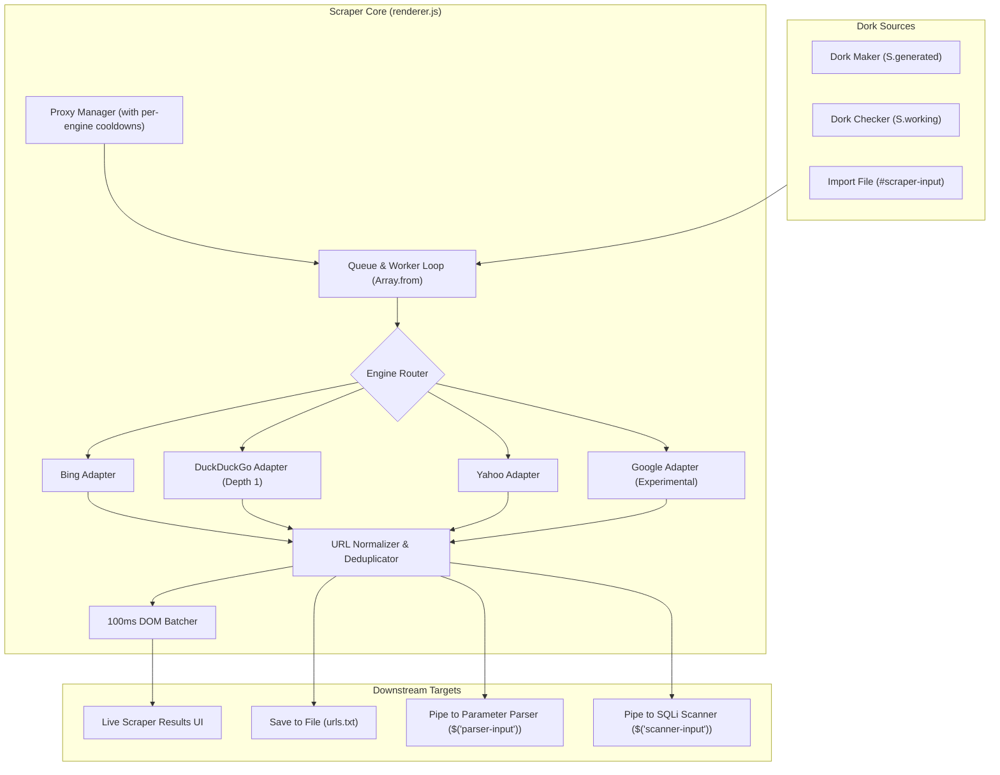

# Multi-Engine Search Scraper Pipeline

* **Author:** bebebe
* **Date:** 2026-10-28
* **Status:** Approved (Post-Review Remediated)

## The Problem
`mango-keywords-node` provides a Dork Maker to generate parameterized search queries and a Checker that tests query validity against Google. However, the system contains no mechanism to collect and extract actual target URLs from search engine result pages (SERPs). 

Users are forced to export dorks, run third-party scrapers outside the application, and manually import collected URLs back into the Parser and Scanner modules. This disconnect breaks the automation loop and leaves downstream vulnerability scanning workflows unpopulated.

## Overview
The Multi-Engine Search Scraper introduces an integrated extraction subsystem that consumes dork queues directly from the Maker (`S.generated`) or imported text files, executes searches across multiple search providers (Bing, DuckDuckGo, Yahoo, Google), extracts and normalizes organic result URLs, and pipes clean target lists directly into the Parser and Scanner.

The scraper operates via lightweight HTTP requests with configurable concurrency, routing through the existing proxy management subsystem with per-engine rate limiting and failover.

## Goals
* **Automated Pipeline Integration:** Provide seamless 1-click handoff from Dork Maker (`S.generated`) or Checker (`S.working`) output directly into the Scraper, and from Scraper results into the Parser and Scanner.
* **Multi-Engine Support:** Implement modular search engine adapters for Bing, DuckDuckGo, Yahoo, and Google, allowing single-engine or round-robin multi-engine dispatch.
* **Proxy-Aware Concurrency & Cooldowns:** Distribute requests across the active proxy pool (`S.proxies`) with per-engine cooldown tracking rather than global proxy disqualification.
* **URL Normalization & Deduplication:** Strip search engine tracking redirects (e.g., Google `/url?q=`, Yahoo `r.search.yahoo.com`), filter out search engine self-domains, strip only advertising tracking tags (`utm_*`, `fbclid`, `gclid`), preserve vulnerability fuzzing parameters (`ref`, `id`), and deduplicate URLs in real time.
* **Resource Efficiency & UI Responsiveness:** Maintain low memory footprint via direct HTTP stream parsing and batched DOM updates (every 100ms) to prevent UI event loop starvation.

## Non-Goals
* **Headless Browser Automation:** Full Chromium/Puppeteer scraping is out of scope; all adapters use lightweight HTTP requests and DOM/regex parsing.
* **Paid CAPTCHA Solver Integration:** Third-party solver APIs (2Captcha, CapSolver) are excluded; blocked proxies enter engine-specific cooldowns.
* **Deep Web Crawling:** Internal page spidering on discovered targets is out of scope; scraping is strictly confined to SERP links.

---

## Technical Plan

### System Architecture & Data Flow

The scraper subsystem runs as an integrated module within the Electron renderer execution loop, using a multi-worker async queue that coordinates request dispatching across multiple search provider adapters.



### Component Breakdown

#### 1. Engine Adapters (`ScraperEngines`)
Each adapter implements a standardized schema:
```typescript
interface SearchEngineAdapter {
  name: 'bing' | 'ddg' | 'yahoo' | 'google';
  buildRequest(query: string, page: number): { url: string; method?: string; headers?: Record<string, string> };
  parseResults(html: string): string[]; // Returns extracted & redirect-unwrapped URLs
  isBlocked(status: number, body: string): boolean;
}
```

* **Bing Adapter:**
  * **Endpoint:** `https://www.bing.com/search?q={query}&first={offset}`
  * **Pagination Strategy:** Offset formula `first = (page - 1) * 10 + 1` (depth 1 to 5).
  * **Extraction Selector:** Matches `href="(https?://(?!www\.bing|go\.microsoft|login\.live)[^"#\s]+)"` inside `.b_algo` blocks.
  * **Redirect Handling:** Direct organic URLs; no intermediate redirect token.
  * **Block Classification:** Status 429, 403, or body containing captcha/challenge markers.
* **DuckDuckGo Adapter:**
  * **Endpoint:** `https://html.duckduckgo.com/html/?q={query}`
  * **Pagination Strategy:** Strictly constrained to `depth = 1` (YAGNI standard: avoids dynamic form token sessions on non-JS HTML endpoint).
  * **Extraction Selector:** Parses `a.result__url` and `<a class="result__snippet" href="(https?://[^"]+)"`.
  * **Redirect Handling:** Unwraps `/l/?kh=-1&uddg={encoded_url}` via `decodeURIComponent()`.
  * **Block Classification:** Status 429, 403, or rate limit notices.
* **Yahoo Adapter:**
  * **Endpoint:** `https://search.yahoo.com/search?p={query}&b={offset}`
  * **Pagination Strategy:** Offset formula `b = (page - 1) * 10 + 1` (depth 1 to 5).
  * **Extraction Selector:** Matches `href="https?://r.search.yahoo.com/[^"]*\/RU=([^/]+)\/"`.
  * **Redirect Handling:** Extracts the `RU=` token and decodes via `decodeURIComponent()`.
  * **Block Classification:** Status 999 (Yahoo anti-bot), 429, 403, or robot check bodies.
* **Google Adapter (Experimental):**
  * **Endpoint:** `https://www.google.com/search?q={query}&start={offset}`
  * **Pagination Strategy:** Offset formula `start = (page - 1) * 10` (depth 1 to 5).
  * **Extraction Selector:** Parses `/url?q=([^&]+)` and organic result anchors.
  * **Redirect Handling:** Unwraps `/url?q=` token via `decodeURIComponent()`.
  * **Block Classification:** Status 429, 403, or body containing `/sorry/Index` (triggers immediate 5-minute engine cooldown for current proxy).

#### 2. URL Normalizer & Deduplicator (`UrlNormalizer`)
* **Syntax Validation:** Uses native WHATWG `new URL(rawUrl)` to ensure RFC compliance.
* **Noise Filter:** Drops search engine domain self-links (`*.google.*`, `*.bing.*`, `*.yahoo.*`, `*.duckduckgo.*`, `*.microsoft.*`, `*.msn.*`, `*.youtube.*`).
* **Canonicalization:** Strips `#fragments`, normalizes scheme and host to lowercase, and removes redundant default ports (`:80`, `:443`).
* **Selective Parameter Cleaning:** Removes only advertising tracking parameters (`utm_*`, `fbclid`, `gclid`). Explicitly preserves application and fuzzing parameters (e.g., `ref`, `id`, `page`, `cat`, `redirect`).
* **Deduplication:** Always deduplicates exact normalized URLs in `S.uniqueUrls` (`Set<string>`). If `#chk-domain-unique` is checked, discards subsequent URLs matching hostnames already present in `S.uniqueDomains`.

#### 3. Worker Concurrency & Engine Cooldown Routing
* **Concurrency Pool:** Configurable worker count (`1` to `30` parallel workers) using the standardized codebase queue pattern:
  ```javascript
  const q = [...tasks];
  await Promise.all(Array.from({ length: threads }, async () => {
    while (q.length && !S.stopScraper) {
      const task = q.shift();
      // execute task with per-engine proxy routing
    }
  }));
  ```
* **Dynamic Pagination Short-Circuit:** Tasks are processed per dork. If an engine's page 1 returns 0 URLs, subsequent pages for that dork on that engine are aborted to conserve requests.
* **Per-Engine Proxy Cooldown:**
  * When `adapter.isBlocked(status, body) === true`:
    * Mark engine cooldown: `if (px) { px.cooldown = px.cooldown || {}; px.cooldown[engineKey] = Date.now() + 300000; }`
    * The proxy remains available for other engines where it is not blocked.
    * Only socket dropouts, connection timeouts, and proxy handshake errors mark `px.status = 'dead'`.
* **Zero-Proxy Fallback:** If `S.proxies` is empty, execute direct connection with concurrency capped at 2 threads and display a status indicator.
* **Status Validation Contract:** All requests must pass `validateStatus: () => true` to Axios so status codes 429, 403, and 999 are returned cleanly to `adapter.isBlocked()`.

#### 4. UI & Downstream Integration (`PipeBridge`)
* **Navigation:** Sidebar button `<button class="nav-btn" data-target="scraper" id="nav-scraper">` and top navigation button `<button class="tab" data-goto="scraper">`.
* **Header Synchronization:** Registered in `TITLES.scraper = ['Search Scraper', 'Thu thập URL mục tiêu từ search engines']`.
* **Downstream Hand-offs:**
  * "From Maker": Injects `S.generated` dorks into `#scraper-input`.
  * "From Working Checker": Injects `S.working` dorks into `#scraper-input`.
  * "Send to Parser": Injects harvested URLs into `$('parser-input').value`, calls `updateParserCount()`, and navigates to `goto('parser')`.
  * "Send to Scanner": Injects harvested URLs containing `?` into `$('scanner-input').value`, updates `$('scanner-count').textContent`, and navigates to `goto('scanner')`.
  * "Export .txt": Native Electron save dialog via `saveFile(S.scraperUrls.join('\n'), 'scraped-urls.txt')`.

---

## Detailed Implementation

### Touched Files Inventory & Rationales

| File | Status | Rationale |
| :--- | :--- | :--- |
| `index.html` | Modified | Add navigation buttons (`#nav-scraper`, `#top-nav [data-goto="scraper"]`), view container `#view-scraper`, controls, counters, and results list. |
| `renderer.js` | Modified | Implement scraper state on `S`, `TITLES.scraper`, `ScraperEngines` mapping, `startScraper()`, `stopScraper()`, normalizer, and DOM/pipe bindings. |
| `style.css` | Modified | Add layout styling for `#view-scraper`, engine tag badges, progress bars, and `.ritem` result cards matching `#10131a`. |
| `i18n.js` | Modified | Add localization rows across `[Vietnamese, English, Arabic, Russian, Chinese]` for all scraper labels and toasts. |
| `README.md` | Modified | Update EGM Component Package contract to reflect scraper interface, invariants, and side effects. |

### Concrete DOM Element IDs

* **Sidebar & Topbar:** `#nav-scraper`, `#top-nav [data-goto="scraper"]`, `#nav-scraper-count`.
* **Inputs & Configuration:** `#scraper-input`, `#scraper-threads`, `#scraper-threads-val`, `#scraper-timeout`, `#scraper-delay`, `#scraper-pages`, `#chk-engine-bing`, `#chk-engine-ddg`, `#chk-engine-yahoo`, `#chk-engine-google`, `#chk-domain-unique`.
* **Action Buttons:** `#btn-scraper-file`, `#btn-scraper-from-maker`, `#btn-scraper-from-checker`, `#btn-start-scraper`, `#btn-stop-scraper`, `#btn-clear-scraper`, `#btn-scraper-save`, `#btn-scraper-to-parser`, `#btn-scraper-to-scanner`.
* **Status & Counters:** `#scraper-status`, `#scraper-bar`, `#scraper-speed`, `#stat-scraper-dorks`, `#stat-scraper-urls`, `#stat-scraper-domains`, `#scraper-list`.

### Step-by-Step Execution Sequence

1. **Phase 1: Markup Scaffolding (`index.html`)**
   * Add `<button class="nav-btn" data-target="scraper" id="nav-scraper"><svg ...></svg><span>Scraper</span><span class="badge" id="nav-scraper-count">0</span></button>` into `.nav-group`.
   * Add `<button class="tab" data-goto="scraper">Scraper</button>` into `#top-nav`.
   * Add `<section class="view" id="view-scraper">` containing:
     * Left column: dork input `#scraper-input`, load buttons, engine checkboxes, depth selector `#scraper-pages`, threads slider, delay input, start/stop buttons.
     * Right column: stats bar (dorks done, URLs found, unique domains, rate), progress bar, live scrollable list `#scraper-list`, and output action buttons.

2. **Phase 2: Visual Styling (`style.css`)**
   * Add layout rules for `#view-scraper` matching `#view-maker` and `#view-checker`.
   * Add engine tag badge styles: `.tag.bing` (blue), `.tag.ddg` (orange), `.tag.yahoo` (purple), `.tag.google` (multi/red).
   * Style scraper control grid, result items (`.ritem`), and action button row.

3. **Phase 3: State Initialization & Navigation Hook (`renderer.js`)**
   * Add scraper state attributes to `S`:
     ```javascript
     S.scraperDorks = [];
     S.scraperUrls = [];
     S.uniqueUrls = new Set();
     S.uniqueDomains = new Set();
     S.stopScraper = false;
     ```
   * Register `TITLES.scraper = ['Search Scraper', 'Thu thập URL mục tiêu từ search engines']`.
   * Update `btn-reset-all`:
     ```javascript
     S.scraperDorks = [];
     S.scraperUrls = [];
     S.uniqueUrls = new Set();
     S.uniqueDomains = new Set();
     S.stopScraper = false;
     ```
   * Update `refreshStats()` to sync `$('nav-scraper-count').textContent = S.scraperUrls.length`.

4. **Phase 4: Adapters & URL Normalizer (`renderer.js`)**
   * Implement `ScraperEngines` mapping (Bing, DDG, Yahoo, Google) with `buildRequest`, `parseResults`, and `isBlocked`.
   * Implement `normalizeTargetUrl(rawUrl)` using WHATWG `new URL()`:
     * Unescape protocol and host.
     * Strip `#hash` and query keys matching `/^(utm_|fbclid|gclid)/i`.
     * Retain target query parameters like `id`, `ref`, `cat`.
   * Implement `isBlacklistedDomain(hostname)` checking for search engine self-domains.

5. **Phase 5: Worker Concurrency & Batch Rendering Loop (`renderer.js`)**
   * Implement `pickProxyForEngine(engineKey)`: selects an available proxy where `!proxy.cooldown?.[engineKey] || proxy.cooldown[engineKey] < Date.now()`.
   * Implement `scrapeOneDorkPage(dork, engineKey, page, timeout, delay)`:
     * Execute Axios GET with `validateStatus: () => true`, headers, and proxy agent.
     * Guard proxy failure:
       ```javascript
       if (adapter.isBlocked(res.status, res.data)) {
         if (px) {
           px.cooldown = px.cooldown || {};
           px.cooldown[engineKey] = Date.now() + 300000;
           if (S.stickyProxy?.key === px.key) S.stickyProxy = null;
           refreshProxyUI();
         }
         return { blocked: true, urls: [] };
       }
       ```
     * Return extracted URLs from `adapter.parseResults(res.data)`.
   * Implement `startScraper()` using `Array.from({ length: threads })`:
     * Throttle UI updates to `#scraper-list` and `#scraper-bar` every 100ms.
     * Dynamically break page loops for a dork if a page returns 0 URLs.

6. **Phase 6: Downstream Pipeline Bridges (`renderer.js`)**
   * Wire `#btn-scraper-from-maker`: `$('scraper-input').value = S.generated.join('\n');`
   * Wire `#btn-scraper-from-checker`: `$('scraper-input').value = S.working.join('\n');`
   * Wire `#btn-scraper-to-parser`:
     ```javascript
     $('parser-input').value = S.scraperUrls.join('\n');
     updateParserCount();
     goto('parser');
     ```
   * Wire `#btn-scraper-to-scanner`:
     ```javascript
     const qUrls = S.scraperUrls.filter(u => u.includes('?'));
     $('scanner-input').value = qUrls.join('\n');
     $('scanner-count').textContent = qUrls.length + ' URLs';
     goto('scanner');
     ```
   * Wire `#btn-scraper-save`: save via `saveFile(S.scraperUrls.join('\n'), 'scraped-urls.txt')`.

7. **Phase 7: Internationalization (`i18n.js`)**
   * Append 5-tuple localization entries `[Vietnamese, English, Arabic, Russian, Chinese]` for all scraper labels, buttons, and status toasts.

8. **Phase 8: Contract Documentation Update (`README.md`)**
   * Document new scraper state properties, engine adapter signatures, invariants, and outbound network side effects in `README.md`.
